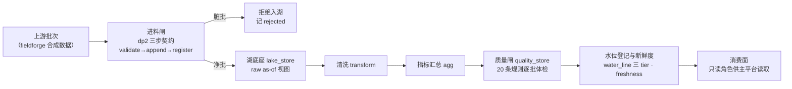

# tpa-data-plane —— Petro-Agent 数据面仓

Petro-Agent 平台的**数据面真实实现**：湖底座 / 进料与新鲜度 / 质量闸 / 指标语义 / 治理与审计。一句话：把上游数据安全地变成平台敢用的数——**进料→清洗→出汇总→质检→报水位**，一条周期管道跑通，每一步都有闸。

   

## 项目地图（同一项目的各部分 GitHub 仓）

| 仓库 | 角色 | 可见性 |
|---|---|---|
| [petro-agent-platform](https://github.com/zzwcoding/petro-agent-platform) | 平台实现仓：后端 `app/`＋`appv2/` · 前端 `web/` · 本体 `ontology/`（已并入） | 公开 |
| [teach-petro-agent-public](https://github.com/zzwcoding/teach-petro-agent-public) | 设计/教学真源仓：合同册 specs/api · ADR 链 · 业务设定 · 架构大图 · 前端原型 | 公开 |
| **本仓** [tpa-data-plane](https://github.com/zzwcoding/tpa-data-plane) | 数据面仓：独立数据服务（进料→清洗→出汇总→质检→报水位） | 公开 |
| [fieldforge](https://github.com/zzwcoding/fieldforge) | 油气领域合成数据生成工作台（本仓的测试数据供给方） | 公开 |

本地布局：本仓嵌套于平台仓 `data-plane/` 目录，平台仓 `.gitignore` 排除——独立 git、独立提交节奏，内容一律回本仓提交推送。

## 功能架构



管道里的四道关键闸：

- **进料幂等闸**：湖 as-of 当前视图与源逐格一致＝内容未变零追加（不建新批、不重刷汇总、不报水位）；视图被旧批覆写≠源＝整批重灌重建真值——修复方向宁重灌不漏灌。同内容重跑/每日重跑零变更。
- **进料规则闸**：注水/检修/设备/流体/沉降/措施台账等表逐批过规则体检（主键非空、值域、日期序），脏批拒绝入湖并留痕。
- **质量闸**：质检跑批落库，指标语义有据可查。
- **治理与审计**：路由拒答、消费面权限（只读角色 / 限写账号分立）、操作审计留痕。

## 文件架构

```
tpa-data-plane/
├── app/data_plane/       # 核心：九个模块
│   ├── lake_store.py     #   湖底座：批次落湖与 as-of 视图（含列规格只读面 column_specs）
│   ├── ingest.py         #   进料：三步契约编排，幂等闸在此
│   ├── transform.py      #   清洗
│   ├── agg.py            #   指标汇总（agg 刷新）
│   ├── quality_store.py  #   质量闸：规则体检与质检落库
│   ├── freshness.py      #   水位线（三 tier）与新鲜度
│   ├── governance.py     #   治理：路由拒答 · 指标语义
│   ├── pg_store.py       #   PostgreSQL 存储访问
│   └── audit.py          #   审计留痕
├── worker/               # 周期管道与运维件
│   ├── scheduler.py      #   APScheduler 独立 worker：日度进料→清洗→质检→agg→水位→报水位
│   └── gc.py             #   湖桶孤儿对象清点（只列不删——先列后删两步制第一步）
├── serve/                # API 面（已退役，见下节「退役说明」）
├── migrations/           # SQL 迁移：lake_schemas · agg_writer · midplatform_readonly（只读角色）·
│                         #   quality_writer（限写账号）
├── tests/                # 按票分目录（dp1…dp9）＋ pg 集成套 ＋ worker ＋ migrations ＋ 误指机闸
├── tools/                # migrate.py（迁移执行） · check_specs.py（规格闸）
├── specs/                # modules.md 模块卡 · s1_tracer_bullet.md 曳光弹规格
├── docs/                 # adr（0001 架构图v1过审 · 0002 持久化选址 PostgreSQL 一库三用）·
│                         #   prd.md（D1–D9）· agents 开发纪律
├── deploy/               # 部署件
├── ci.sh                 # 本地 CI 闸：spec gate + pytest
└── pyproject.toml        # pytest rootdir 锚定（阻断向主仓拾取配置——两仓隔离收口）
```

## 退役说明（问答面已归位主平台）

`serve/api.py` 的问答查询面按 **DP-02 裁决（ADR-0003）退役**：语义、查询执行、对外工具面职责归主平台承接（语义＝C1/semantics、查询＝chat LangGraph 链＋安检、对外工具＝F1 expose）。退役路由恒返回 410 Gone（带归位说明），退役前实现留档对照。本仓现在的对外形态＝**周期管道 worker ＋ 只读消费面**：主平台经只读角色直接读取湖中数据。

## 技术选型

| 层 | 选型 | 在项目中的角色 |
|---|---|---|
| 运行时 | Python + uv | 依赖锁定（uv.lock） |
| 持久化 | PostgreSQL 一库三用（ADR-0002） | 湖（raw as-of）· 汇总（agg）· 治理账（质量/水位/快照）同库分 schema |
| 权限分立 | SQL 角色迁移 | midplatform 只读角色（消费面）· quality 限写账号（质检面）——schema 级 GRANT 固化进迁移 |
| 调度 | APScheduler | 独立 worker 进程跑周期管道（六件事一日一轮） |
| 质量闸 | pytest | hermetic 套件 151 例 ＋ PG 集成套 208 例（迁移双向/agg 星型/限写账号） |
| 机闸 | tools/check_specs.py ＋ test_db_guard | 规格闸；测试库误指防线（DSN 库名不在白名单即拒启动，fail-closed） |
| CI | bash ci.sh | spec gate + 测试，无远端阶段的等效门禁 |

## 组织架构（仓间协作）

- **设计蓝本**：teach 教学仓的模块卡 ＋ W-DP 走查断言 ＋ 20 条数据质量规则 ＋ 15 张指标卡——本仓不发明语义，逐条对号实现。
- **测试数据**：fieldforge 合成数据生成器供给上游批次。
- **施工纪律**：按 sdd-flow 流程开发（不做教学环节，只记施工票）；DP 票系与主仓 V2 票系对齐（进料幂等闸＝主仓票 V2-11/P-011）。
- **与主平台的边界**：本仓不碰问答语义；语义/查询/工具面已归位主平台（见退役说明）。

## 快速开始

```bash
git clone https://github.com/zzwcoding/tpa-data-plane.git
cd tpa-data-plane
python3 -m pytest -q        # hermetic 套件（不需要数据库）
bash ci.sh                  # spec gate + 测试（本地等效门禁）
# PG 集成套：设 TEST_DATABASE_URL 指向白名单测试库（petro_test）后跑 pytest（独占库要求见测试文档字符串）
```

迁移与 schema 授权：`python3 tools/migrate.py`（正反向迁移；灌库必补授权步骤已固化——角色存在性检查 ＋ schema 级 GRANT）。

## 文档指引

| 想看什么 | 去哪 |
|---|---|
| 数据面 PRD（D1–D9 功能点） | 本仓 `docs/prd.md`；上溯真源 [teach-petro-agent-public](https://github.com/zzwcoding/teach-petro-agent-public) `docs/prd-data-plane.md` |
| ADR：架构图 v1 过审 · 持久化选址一库三用 | 本仓 `docs/adr/` |
| 模块卡与曳光弹规格 | 本仓 `specs/modules.md` · `specs/s1_tracer_bullet.md` |
| 质量规则与指标卡的原始定义 | teach-petro-agent-public `docs/business-setting.md` |
