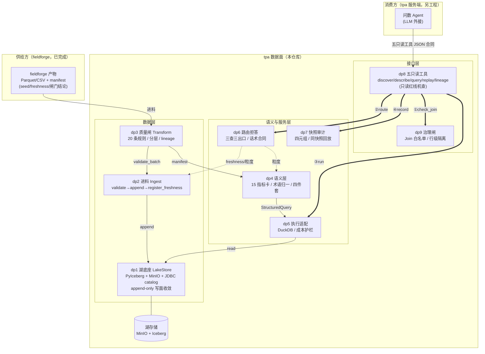

# 架构图 v1 —— tpa 数据面

> 阶段 2 产物（Mermaid）。过审记录落 `docs/adr/0001-架构图v1过审.md`。

## 节点说明（过审导览）

| 节点 | 职责一句话 | 关键纪律 |
|---|---|---|
| FF 供给方 | 造数+验证，送到湖边 | 不入湖（边界在文件+manifest） |
| dp2 进料 | 唯一合法写入口之一 | provenance 随 commit 落元数据 |
| dp3 质量闸 | 唯一合法写入口之二；20 规则机判 | 两证放行=测试全绿+源新鲜 |
| dp1 湖底座 | append-only、快照隔离、写面收敛 | append 仅 dp2/dp3 可调 |
| dp4 语义层 | 口径唯一暴露面，禁发明 | 对齐闸=与 dp3 manifest 比对 |
| dp5 执行适配 | 结构化查询→引擎 | 四拍主干闸前置 |
| dp6 路由拒答 | 诚实声明，零编数 | 不读湖表数据 |
| dp7 快照审计 | 结论可回放可追责 | 绝不静默换快照 |
| dp9 治理闸 | 白名单默认拒绝+行级隔离 | 只持规则不持数据 |
| dp8 五工具 | Agent 唯一接缝 | 四道闸顺序即合同；写意图=拒绝 |

## 数据流（老王问数 tracer bullet 的路）

fieldforge 产物 → dp3 质检 → dp2 入湖（snapshot N）→ 用户问"渤南区块上月产量完成率" → dp4 build_query（术语归一+修饰词消歧）→ dp9 白名单 ✓ → dp6 路由：月度指标×历史窗 → 答离线面 → dp5 DuckDB 执行（快照 N）→ dp7 记录四元组 → AnswerBundle 四件齐 → Agent 流式解读。
